# Awesome Isolated Test Sandbox Environment 🧪⚡

  

# 🚀 Top Isolated Test Sandbox Environment Ecosystem

**A Curated Directory of SaaS Platforms & Open-Source Infrastructure for Ephemeral Sandboxes, Local Cloud Emulation, PR Preview Environments, MicroVMs & Browser Runtimes**

  <b>Search keywords &amp; SEO tags:</b>
  <code>ephemeral environments</code> • <code>test sandbox</code> • <code>isolated staging</code> • <code>pr preview environments</code> • <code>localstack aws emulation</code> • <code>microvms</code> • <code>firecracker</code> • <code>browser sandboxes</code> • <code>testcontainers</code> • <code>cloud development environments (cde)</code> • <code>ai code execution sandbox</code>

---

## 📑 Table of Contents
- [🎯 Sector Overview & Market Dynamics](#-sector-overview--market-dynamics)
- [🏢 SaaS & Hosted Platforms](#-saas--hosted-platforms)
- [🔓 Open-Source GitHub Projects](#-open-source-github-projects)
- [🛠️ Architectural Patterns & Frameworks](#️-architectural-patterns--frameworks)
- [🤝 How to Contribute](#-how-to-contribute)
- [💖 Support & Sponsorship](#-support--sponsorship)
- [📊 Star History](#-star-history)
- [⚖️ Disclaimer](#️-disclaimer)

---

## 🎯 Sector Overview & Market Dynamics

The global market for **Test Environment as a Service (TEaaS)** and **Cloud Development / Ephemeral Sandbox Environments** is estimated between **$17.2B and $20.6B**, expanding rapidly at a compound annual growth rate (**CAGR**) of roughly **19.5%** as engineering organizations abandon rigid static staging clusters in favor of on-demand preview sandboxes.

The sector is **moderately fragmented**: core container and local runtimes exhibit strong brand concentration around market anchors (like Docker, Vercel, and Salesforce/Heroku), whereas pull-request staging orchestration, Environments-as-a-Service (EaaS), and AI agent execution sandboxes remain dynamic and distributed across specialized innovators (LocalStack, StackBlitz, Gitpod, Okteto, and Release).

---

## 🏢 SaaS & Hosted Platforms

> [!NOTE]  
> Sorted descending by company size (valuation / estimated enterprise scale). All pricing columns list explicit entry-tier prices, and free-tier limits define exact perpetual or trial allocations.

| Product / Platform | Company Scale (Valuation / Revenue) | Starting Pricing (Paid Tier) | Free Tier Limits / Policy | Description & Sandbox Capabilities |
| :--- | :--- | :--- | :--- | :--- |
| **[Vercel Preview Environments](https://vercel.com)** | **$9.3B valuation** (~$200M+ ARR) | **$20/user/month** (Pro plan) | **Hobby Plan (Free forever)**: Strictly non-commercial; includes up to 200 projects, 100 GB Fast Data Transfer, 1,000,000 function invocations/mo, 10 GB edge cache, and 300s function duration. Hard pauses on quota exhaust. | Automated deployment platform generating isolated, shareable preview URLs and sandbox builds for every Git branch and pull request. |
| **[Heroku Review Apps](https://heroku.com)** | **$41.5B+ parent (Salesforce)** (~$249M acquisition; estimated hundreds of millions ARR) | **$5/month** (Eco dyno pool) or **$7/month** (Basic dyno) | **No perpetual free tier**; free access is exclusively provided via the GitHub Student Developer Pack (**$13/mo in platform credits for 24 months = $312 total**). Regular accounts require card validation. | Ephemeral full-stack application instances spun up automatically per pull request, tearing down upon PR merge. |
| **[BrowserStack Sandbox / Live](https://browserstack.com)** | **$4.0B valuation** (~$225M+ ARR) | **$12.50/month** (Freelancer annual) / **$29/month** (Desktop Live annual) | **Free Trial**: Includes **30 total minutes** of manual browser and device testing across desktop and real mobile devices (session capped at ~1–2 min per device). | Cloud-hosted browser and real-device testing sandbox allowing QA validation of private staging servers and PR previews behind firewalls. |
| **[Docker Desktop](https://docker.com)** | **$2.1B valuation** (~$207M+ ARR) | **$5/user/month** (Pro plan billed annually) | **Personal Plan (Free forever)**: Free for individuals, education, open source, and small businesses (<250 employees AND <$10M annual revenue). Limit: 1 user, 1 private repo, 100 pulls/6hr. | Standardized local container runtime with isolated Kubernetes cluster, Docker Extensions, and container sandboxing. |
| **[StackBlitz](https://stackblitz.com)** | **$700M valuation** (Backed by Greylock, Google Ventures; tens of millions ARR) | **$18/user/month** (Pro plan billed annually) / $25/mo monthly | **Personal Plan (Free forever)**: Unlimited public projects & public GitHub repos; WebContainer browser sandbox execution; capped at 1MB individual asset uploads; private repos require paid plan. | Instant browser-based development environments powered by WebContainers to boot Node.js runtimes securely within client browser tabs. |
| **[LocalStack (Cloud / Pro)](https://localstack.cloud)** | **$100M–$250M est. valuation** ($28.2M funding; Series A Nov 2024; $10M+ ARR) | **$39/user/month** (Base plan billed annually) | **Hobby Plan (Free forever)**: Strictly non-commercial; requires user account & auth token; includes core AWS emulators (S3, Lambda, DynamoDB, SQS, SNS). Students get free pro via GitHub Pack. | Comprehensive local cloud stack emulator running in a single Docker container to test AWS serverless and cloud workflows in total isolation. |
| **[Release.com](https://release.com)** | **$80M valuation** ($22.9M funding; backed by Sequoia & CRV) | **Custom Enterprise pricing** (Environment-hour & cloud-usage based) | **Sandbox Trial**: Includes **5 free environment hours** upon connecting GitHub/GitLab; offers **100 free managed environment hours/month** on starter cloud-connected tiers. | Environments-as-a-Service (EaaS) platform automating ephemeral full-stack staging sandboxes and PR preview clusters on AWS, GCP, and Kubernetes. |
| **[Okteto](https://okteto.com)** | **$60M valuation** ($18.1M funding; backed by Two Sigma & YC) | **Custom Scale pricing** (per-seat; historical Cloud Pro was $19/user/mo) | **Starter Plan (Free forever)**: 1-year renewable free self-hosted license on your own Kubernetes cluster; supports up to **5 users** and **500 ephemeral environments/month**. | Cloud-native development platform delivering production-like Kubernetes preview environments and isolated namespaces for developer PRs. |
| **[CodeSandbox](https://codesandbox.io)** | **$51M valuation** (Acquired by Together AI; $15.2M funding) | **$12/workspace/month** (Pro plan) | **Free Workspace Plan**: Includes basic browser sandboxes, public repositories, up to 5 team members, and up to 10 concurrent microVM sandboxes for prototyping. | Cloud development and testing sandbox platform offering microVM-backed environments with instant snapshots for PR previews and AI agents. |
| **[Gitpod](https://gitpod.io)** | **$41M total funding** (~$4M ARR; backed by General Catalyst) | **$20/month base** (Team plan with pay-as-you-go compute) | **Free Plan**: Includes **50 hours per month** (500 workspace credits) of standard cloud development environments for personal and open-source repos. | Automated, ephemeral cloud development environments (CDE) configured via code to spin up isolated dev containers from any Git commit. |

---

## 🔓 Open-Source GitHub Projects

> [!TIP]  
> Sorted descending by GitHub stargazers count. Stars_Badges link directly to each repository's stargazers community page.

| Project | GitHub_Stars_Badge | Category / Architecture | Description |
| :--- | :--- | :--- | :--- |
| **[Daytona](https://github.com/daytonaio/daytona)** |  | Development Environment Manager | Open-source development environment manager that automates standardized, isolated workspace environments with a single command. |
| **[Coolify](https://github.com/coollabsio/coolify)** |  | Self-Hosted PaaS & Previews | Self-hosted, privacy-first alternative to Heroku/Vercel featuring automated pull-request preview deployments inside isolated containers. |
| **[LocalStack](https://github.com/localstack/localstack)** |  | Local Cloud Emulation | Fully functional local AWS cloud stack emulator enabling offline integration testing for S3, Lambda, SQS, DynamoDB, and dozens more. |
| **[Docker Compose](https://github.com/docker/compose)** |  | Container Orchestration | Multi-container Docker application orchestrator for defining reproducible, isolated local service networks and integration testing setups. |
| **[Firecracker](https://github.com/firecracker-microvm/firecracker)** |  | MicroVM Hypervisor | Secure, fast, lightweight Virtual Machine Monitor built in Rust by AWS for hardware-isolated microVM sandboxes in serverless runtimes. |
| **[Podman](https://github.com/containers/podman)** |  | Rootless Container Engine | Daemonless, rootless container engine for developing, managing, and running OCI containers and isolated pods securely on Linux/macOS/Windows. |
| **[Minikube](https://github.com/kubernetes/minikube)** |  | Local Kubernetes Cluster | Fast local Kubernetes cluster provisioner running inside a VM or container for isolated integration validation and developer sandboxing. |
| **[Dokku](https://github.com/dokku/dokku)** |  | Self-Hosted PaaS | Docker-powered mini-Heroku platform capable of spinning up isolated review apps and ephemeral staging instances per Git branch. |
| **[gVisor](https://github.com/google/gvisor)** |  | Sandbox Container Kernel | Application kernel written in Go by Google providing strong virtualization boundaries by intercepting host syscalls for untrusted code execution. |
| **[Wasmtime](https://github.com/bytecodealliance/wasmtime)** |  | WebAssembly Sandbox Runtime | Fast, secure, standalone WebAssembly and WASI runtime from Bytecode Alliance for executing untrusted user code in zero-overhead sandboxes. |
| **[Coder](https://github.com/coder/coder)** |  | Cloud Development Platform | Self-hosted developer environment platform provisioning isolated workspaces via Terraform across Kubernetes, Docker, and on-prem VMs. |
| **[Dagger](https://github.com/dagger/dagger)** |  | Programmable CI/CD Sandboxes | Programmable CI/CD engine that runs pipelines in isolated BuildKit containers locally and in CI with total cache reproducibility. |
| **[kind (Kubernetes in Docker)](https://github.com/kubernetes-sigs/kind)** |  | CI/CD Kubernetes Testing | Tool for running local multi-node Kubernetes clusters using Docker containers as nodes; primary engine for automated CI test sandboxes. |
| **[DevPod](https://github.com/loft-sh/devpod)** |  | DevContainer Orchestrator | Client-only open-source tool provisioning reproducible DevContainers on any cloud, Kubernetes cluster, Docker engine, or remote VM. |
| **[E2B](https://github.com/e2b-dev/E2B)** |  | AI Agent Sandbox Infrastructure | Secure open-source cloud sandbox runtime built on Firecracker microVMs for running untrusted AI-generated code and agent tool calling. |
| **[Gitpod](https://github.com/gitpod-io/gitpod)** |  | Automated Dev Environments | Open-source platform orchestration codebase for spinning up disposable development environments directly from Git pull requests. |
| **[Toxiproxy](https://github.com/Shopify/toxiproxy)** |  | Chaos & Network Simulation | TCP proxy developed by Shopify for simulating network conditions, bandwidth limitations, and chaos latency inside test sandboxes. |
| **[Devbox](https://github.com/jetify-com/devbox)** |  | Deterministic Nix Environments | Portable command-line tool that creates isolated, deterministic developer shell environments powered by Nix without container virtualization. |
| **[vCluster](https://github.com/loft-sh/vcluster)** |  | Virtual Kubernetes Clusters | Ultra-lightweight virtual Kubernetes clusters running inside namespaces of host clusters, offering isolated multi-tenant staging environments. |
| **[Tilt](https://github.com/tilt-dev/tilt)** |  | Microservice Dev Orchestrator | Microservice development workflow tool managing live updates, container rebuilds, and test execution within isolated local clusters. |
| **[Kata Containers](https://github.com/kata-containers/kata-containers)** |  | Hardware-Isolated Containers | Secure container runtime that builds lightweight virtual machines that feel and perform like containers with dedicated hardware hypervisors. |
| **[Testcontainers](https://github.com/testcontainers/testcontainers-java)** |  | Ephemeral Test Fixtures | Industry-standard library for programmatically spinning up throwaway Docker containers (databases, brokers, mock APIs) inside tests. |
| **[Moto](https://github.com/getmoto/moto)** |  | AWS Mocking Library | Python library enabling in-memory mocking or standalone server emulation of AWS services for isolated integration and unit test runs. |
| **[WireMock](https://github.com/wiremock/wiremock)** |  | HTTP API Mocking Server | Tool for fast HTTP-based API stubbing and simulation, isolating microservices under test from third-party downstream dependencies. |
| **[Telepresence](https://github.com/telepresenceio/telepresence)** |  | Kubernetes Remote Proxy | CNCF proxy tool connecting local workstations to remote Kubernetes clusters so developers can debug single microservices in isolation. |
| **[k3d](https://github.com/k3d-io/k3d)** |  | Containerized Lightweight K8s | Lightweight wrapper to run Rancher's k3s Kubernetes distribution inside Docker containers for rapid ephemeral testing cycles. |
| **[Mirrord](https://github.com/metalbear-co/mirrord)** |  | Microservice Traffic Mirroring | Runs local processes in the context of remote Kubernetes clusters without deploying, providing isolated staging validation. |
| **[DevSpace](https://github.com/devspace-sh/devspace)** |  | Kubernetes Client-Only Tool | Fast developer tool for Kubernetes automating isolated dev/test namespaces, direct file sync, and containerized preview deployments. |
| **[MockServer](https://github.com/mock-server/mockserver)** |  | Service Virtualization | Mocking framework for HTTP and HTTPS APIs, allowing request inspection, proxy recording, and isolated service verification. |
| **[Garden](https://github.com/garden-io/garden)** |  | Graph-Based Dev & CI Platform | Production-like Kubernetes testing automation framework generating fast, graph-cached ephemeral test environments for CI and PRs. |

---

## 🛠️ Architectural Patterns & Frameworks

When architecting an isolated test sandbox environment, choose an isolation boundary matching your workload trust profile:

1. **Lightweight Process & API Isolation (Unit & Integration Testing)**:
   - Use **[Testcontainers](https://github.com/testcontainers/testcontainers-java)** or **[LocalStack](https://github.com/localstack/localstack)** alongside **[WireMock](https://github.com/wiremock/wiremock)** to isolate dependencies without provisioning dedicated infrastructure.
2. **Namespace & Virtual Cluster Isolation (Microservices & Staging)**:
   - Use **[vCluster](https://github.com/loft-sh/vcluster)** or **[kind](https://github.com/kubernetes-sigs/kind)** with automated Helm/Terraform pipelines to spawn ephemeral Kubernetes staging sandboxes per PR.
3. **Hard Kernel & Hypervisor Isolation (AI Code Execution & Untrusted Code)**:
   - Use **[Firecracker MicroVMs](https://github.com/firecracker-microvm/firecracker)** (via **[E2B](https://github.com/e2b-dev/E2B)**) or **[gVisor](https://github.com/google/gvisor)** to guarantee strict hypervisor boundaries, memory isolation, and network egress restrictions.

---

## 🤝 How to Contribute

Contributions are warmly welcomed! 🌟 Follow these steps:

1. 🍴 **Fork the repository**.
2. 🌿 Create your feature branch (`git checkout -b feature/awesome-addition`).
3. 📝 Add your tool adhering to alphabetical/star ordering and include factual starting prices or Stars_Badges.
4. 🚀 Open a Pull Request with a clear description of the sandbox or preview capability.

---

## 💖 Support & Sponsorship

If this curated catalog helps you build faster, cleaner, and more secure test sandboxes, please consider supporting the project:

- ⭐ **Star this repository** to help others discover it.
- 🍴 **Fork and share** with your DevOps, Platform, and QA teams.
- ☕ **Buy a coffee or sponsor ongoing maintenance**: Check out the [GitHub Sponsor Dashboard](https://github.com/sponsors/ishandutta2007) to support open-source development!

---

## 📊 Star History

---

## ⚖️ Disclaimer

- This is a **community-curated** list — listings do not imply commercial endorsement.
- Sandboxes executing untrusted code or automated AI agent tasks should strictly enforce kernel/hypervisor sandboxing (Firecracker, gVisor, Kata Containers), strict firewall rules, and short TTL limits to avoid resource exhaustion.
- Always configure automated TTL policies to prevent cloud cost sprawl from orphaned preview environments.

---

  Maintained with ❤️ for DevOps engineers, SDETs, platform architects, and cloud-native developers.

